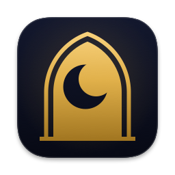

# Salah



A calm macOS menu-bar app for the five daily prayers, with desktop widgets and adhan alerts.

[](https://github.com/salah-kit/Salah/actions/workflows/ci.yml)
[](https://github.com/salah-kit/Salah/releases)
[](LICENSE)

## What it is

Salah lives in your menu bar. It shows how long until the next prayer, opens a dropdown
with the day's schedule, brings the same schedule to desktop and Notification Center
widgets, and sounds the adhan when a prayer begins.

| Menu bar | Arabic, right to left | Widgets |
| :---: | :---: | :---: |
|  |  | <br> |

These images are the test suite's own renders ([`SalahTests/Baselines`](SalahTests/Baselines/README.md)),
checked on every change, so they show what the app draws today.

- **The menu bar.** A countdown or the next prayer's time, which turns red in the last
  15 minutes and green for a 15-minute count-up after the adhan. The dropdown shows the
  Hijri date, the six times, per-prayer alert toggles, silent mode and a stop button.
- **Widgets** in small, medium and large sizes, with a stop button while audio plays.
  The widget calculates its own times, so it stays right on days Salah isn't running.
- **Alerts.** Per-prayer adhan alerts with before and after reminders, a Jumu'ah
  override, six built-in recordings or your own audio, a du'a after the adhan, and a
  catch-up when the Mac wakes from sleep.
- **Calculation.** Eleven methods plus custom angles, Shafi or Hanafi Asr, high-latitude
  rules, per-prayer adjustments, a Hijri offset and a delayed Isha in Ramadan.
- **Nine languages:** English, Arabic, French, Urdu, Indonesian, Turkish, Persian,
  Bengali and Malay, with right-to-left layouts and local digits.
- **Private.** Prayer times are computed on your Mac, and work offline. The only
  network use is Apple's: your coordinates go to Apple's geocoding service to name your
  city, and what you type in the location search goes to Apple Maps' search. No
  accounts, no analytics, no tracking.

What it deliberately isn't:

- It isn't a mosque timetable app: it calculates times from your location, and doesn't
  show a mosque's published iqama times.
- It isn't on the Mac App Store, and there is no signed download yet. Salah is released
  as source; you build it yourself.
- It's macOS only. The prayer-time code it is built on,
  [SalahKit](https://github.com/salah-kit/SalahKit) and
  [SalahTimes](https://github.com/salah-kit/SalahTimes), is how other apps on other
  platforms share it.

Salah is the [salah-kit](https://github.com/salah-kit) ecosystem's own app and a working
sample of the packages, used through their public API only. SalahTimes calculates the
times (SalahCalculation); SalahCore decides which prayer is next, which just started and
what a day can't give; the widget extension builds its own timelines from settings the
app mirrors into their shared App Group (SalahWidgets); the rows and the focus are
SalahUI's components in Salah's own styles; and SalahAlerts plans the alerts, installs
the ones macOS can keep and follows every one while the app runs. Salah's look, settings,
sounds and wording stay in the app.

## Installation

Build it with Xcode 27 on macOS. The app runs on macOS 14 or later.

1. Clone the repo and add your signing team. The app shares an App Group with its widget,
   so it needs a team to run; a free Apple Developer account works.

   ```sh
   git clone https://github.com/salah-kit/Salah.git
   cd Salah
   cp Config/Local.xcconfig.example Config/Local.xcconfig
   # Edit Config/Local.xcconfig: DEVELOPMENT_TEAM = <your team ID>
   ```

2. Build a release copy:

   ```sh
   xcodebuild build -project Salah.xcodeproj -scheme Salah -configuration Release \
     -destination 'platform=macOS' -derivedDataPath build -allowProvisioningUpdates
   ```

   Or open `Salah.xcodeproj` in Xcode and run the `Salah` scheme.

3. Move `build/Build/Products/Release/Salah.app` to `/Applications` and open it.

## Quick start

1. Open Salah. A moon-and-stars icon and the time to the next prayer appear in the menu
   bar; click them for the day's schedule.
2. Open Settings (the gear in the dropdown, or ⌘,). In **Location**, use your current
   location or search for a city. **Calculation** picks a method from your country; you
   can change it.
3. In **Notifications**, choose each prayer's alert and reminders. macOS asks for
   permission the first time Salah has an alert to schedule.
4. To add a widget, right-click the desktop, choose **Edit Widgets**, and search for
   Salah.

## Documentation

This README and [CONTRIBUTING.md](CONTRIBUTING.md) cover using and building the app. The
visual baselines' [index](SalahTests/Baselines/README.md) lists every widget and menu
state the tests render. The packages Salah builds on document their APIs in their own
repos: [SalahKit](https://github.com/salah-kit/SalahKit) and
[SalahTimes](https://github.com/salah-kit/SalahTimes).

## Supported platforms

macOS 14 Sonoma or later, on Apple silicon and Intel Macs.

## Status and versioning

Salah 1.1.2 is a source release on SalahKit 0.4.0. Releases use a
marketing version (1.1.2) and a build number; [CHANGELOG.md](CHANGELOG.md) records every
change.

Not done yet: a signed and notarized download, a Mac App Store listing, and confirmation
of the rights to redistribute the bundled adhan recordings (see [NOTICE](NOTICE)). Native-language
review includes the new volume accessibility label.

Custom-theme guardrails use SalahUI's default 3:1 contrast floor against an opaque base
surface, intended for the large countdown. Caption headings and the silent-mode label use separate semantic ink, checked at 4.5:1
against their composed preset surfaces in light/dark and Increase Contrast. Decorative
accents retain the chosen palette. This focused check does not certify every secondary,
functional-tone or custom-theme text/background combination.

## Contributing

See [CONTRIBUTING.md](CONTRIBUTING.md) for building, testing, formatting and releasing. The
org-wide code of conduct and security policy live in
[salah-kit/.github](https://github.com/salah-kit/.github). Checks that need a real Mac, time
or a native speaker are open issues labelled
[`help wanted`](https://github.com/salah-kit/Salah/issues?q=is%3Aissue+is%3Aopen+label%3A%22help+wanted%22).

## License

MIT. See [LICENSE](LICENSE). The bundled audio recordings aren't covered by it: see
[NOTICE](NOTICE).
